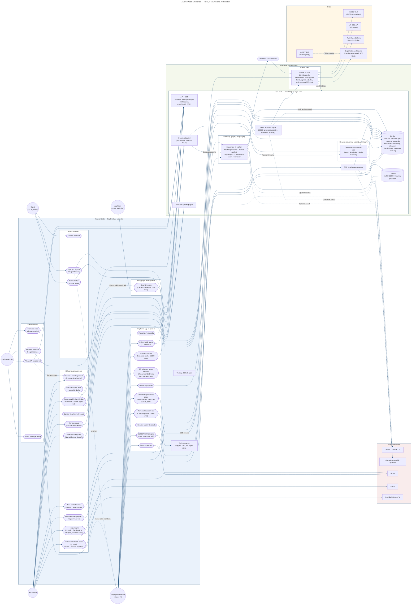

# AiversePulse Enterprise

> An AI multi-agent workforce platform that tracks AI advancement daily, predicts which skills and roles are emerging or under pressure, matches people to future roles, and builds a personalised 90-day reskilling plan, for individual workers and for HR teams.

---

## Team Information

| Field                  | Details                                                        |
| ---------------------- | -------------------------------------------------------------- |
| **Team Name**          |          NoBugPls                                                |
| **Team Domain**        |        Domain 1                                                |
| **SDG Track (1–17)**   | SDG 8 — Decent Work and Economic Growth (with SDG 4 — Quality Education) |
| **Team Leader**        | Tang Yu Shan                                                         |
| **University**         | Universiti Teknologi Malaysia (UTM); Universiti Tunku Abdul Rahman (UTAR)                                                      |
| **Number of Members**  | **5**                                                        |

## Links

| Resource          | Link                                                                 |
| ----------------- | -------------------------------------------------------------------- |
| GitHub Repository | https://github.com/yushan1101/SDC_Hackathon_Submission_NoBugPls      |
| Replit Project    | _TODO_                                                               |
| Live Demo         | _TODO_                                                               |
| RunPod Endpoint   | _TODO: https://api.runpod.ai/v2/&lt;endpoint-id&gt;_                 |
| Slide Deck        | _TODO_                                                               |
| Demo Video        | _TODO_                                                               |

---

## Overview

### Problem

AI is reshaping work faster than people can re-skill. Employers expect **39% of key skills** to change by 2030,
and **59 of every 100 workers** will need training by then, with 11 of them unlikely to receive it
([WEF Future of Jobs Report 2025](https://www.weforum.org/publications/the-future-of-jobs-report-2025/)).
Workers don't know which of their skills are rising or fading, and HR teams screen and plan training without
current evidence. Meanwhile AI résumé screeners can be fooled by hidden "prompt injection" text.

### Solution

AiversePulse runs a team of AI agents (LangGraph + an MCP tool server):

- **Daily trend signals.** One agent reads a daily AI-trend board built from public news, research and job-posting signals.
- **Profile and matching.** Others profile the person from a quick quiz or a résumé and match them across ~3,000 occupations in ESCO, the European Commission's public skills taxonomy.
- **Plan with sources.** The rest predict skill gaps under two AI scenarios and write a cited 30/60/90-day plan.

A person approves every plan and every hiring decision.

Models trained offline on O*NET learn how important each skill is and forecast which skills are rising. The STF-KAN outlook runs live on CPU inside the agent workflow (its input is the O*NET release history, checked against the model's manifest); without those artifacts the app serves the model's exported output and says so.

### Key Features

- **Three ways in.** A 13-question quick-match game, a résumé upload converted to Markdown with an evidence quote for every skill, or picking a target job.
- **Daily AI-trend board.** Hacker News, arXiv and live job postings, scored into "emerging" and "automation pressure" for every occupation, with dated evidence.
- **Future-role matching and skill gaps** under *assistive* vs *agentic* AI scenarios, plus a STF-KAN skill-outlook forecast.
- **Personalised 90-day plan.** Fits the learner's weekly hours, cites its sources, and can be edited and approved by a person.
- **AI mock interviews.** Launch only from roles recommended by a completed resume analysis or career game; review past sessions and reports in interview history, answer ESCO-grounded adaptive questions by text or supported browser voice, and compare transparent performance/readiness scores and learning recommendations.
- **UN SDG mapping (all 17).** Every role and plan activity links to official SDG targets.
- **HR hiring.** Thresholds written in plain English, a public apply link, AI screening agents, blind ranked review, and human shortlist/hold/decline with an audit log.
- **Document guard.** Strips hidden PDF/Word text and prompt-injection lines, and flags fraud signals. Risky résumés are held for a human, never auto-rejected.
- **Hiring plugins.** HR connects LinkedIn, Facebook, X, Telegram, Discord or Slack once; a posting agent writes a post for each platform and shares every new opening.
- **Team members by invite.** HR invites people by email (no sign-up page); they set a password from the link, and HR can disable or remove them.
- **Voice and plain language.** Voice input in every browser (paid plans), read aloud, "ask about your team" for HR, and job openings drafted from a spoken description.
- **AI model per task.** The admin lists allowed models; each HR advisor picks one for coaching, resume screening and job posts.

### Tech Stack

| Layer         | Technology                                                                 |
| ------------- | -------------------------------------------------------------------------- |
| Frontend      | Plain HTML/CSS/JavaScript ES modules (`src/web/`, no build step), rigged SVG owl companion |
| Backend       | Python 3.11, FastAPI (Server-Sent Events streaming); two LangGraph graphs (reskilling, resume screening); RAG chat, mock-interview and recruiter/posting agents; FastMCP tool server on a worker node |
| Database      | SQLite (accounts, sessions, plan versions, approvals, HR reviews, recruiting, interviews, trend history, payments, audit log); Chroma (18,444 ESCO + learning passages) |
| AI / Compute  | MiniLM sentence embeddings, STF-KAN forecaster (PyTorch), requirement model (PyTorch); GPU training via RunPod (`runpod/handler.py`); optional Gemini 3.1 Flash-Lite and an OpenAI-compatible gateway (coach, chat, interview questions and speech-to-text, screening, job posts) |
| Hosting / Dev | Frontend: static `src/web/` on Replit. Backend: dual-node VPS — main FastAPI node (sdc.olgtx.com) and a worker node for the FastMCP tools behind a Cloudflare MCP balancer; Docker |
| Data          | ESCO v1.2 (live), UN SDG API (live), HN / arXiv / Arbeitnow / Remotive (live, daily); O*NET 31.0 (training only) |

---

## Project Structure

```
.
├── docs/                    # Requirements trace, architecture, technical notes, data sources, API contracts, AGENTS.md
├── runpod/
│   ├── handler.py           # RunPod serverless handler (GPU: STF-KAN training, requirement model, embeddings)
│   └── Dockerfile           # GPU worker image (build from the repo root)
├── src/
│   ├── main.py              # Application entry point (starts the web app + API)
│   ├── agents/              # Profiler, knowledge, gap analyst, pathway, coach, matcher, quiz, resume, SDG, criteria
│   ├── core/                # LangGraph pipelines (reskilling graph, resume screening), shared state
│   ├── mcp_server/          # FastMCP tools, RAG retrieval (Chroma), daily AI-trend signals
│   ├── server/              # FastAPI app (public + HR APIs, SSE streaming)
│   ├── validation/          # Reviewer repairs, document guard (prompt-injection / fraud filters)
│   ├── governance/          # Accounts, approval workflow, recruiting store, audit log
│   ├── forecasting/         # STF-KAN model, training and evaluation
│   ├── config/ tools/ ui/   # Settings, helpers, Streamlit fallback UI (app.py)
│   ├── web/                 # Static frontend: public site, HR console, apply page, config.js (deployable on its own)
│   ├── data/                # snapshots/ (live public data + model outputs), training_snapshots/ (training only), samples/
│   ├── scripts/             # Data builders, training and export (ESCO, SDG map, STF-KAN, requirement model)
│   ├── deploy/              # Separate frontend (nginx) + API docker-compose example
│   ├── Dockerfile           # CPU image for the web app + API (build context: src/)
│   ├── pyproject.toml       # Package metadata and dependencies
│   └── uv.lock              # Locked Python dependencies
├── submission/              # Required submission documents
│   ├── REPLIT PROOF OF USE.pdf
│   ├── RUNPOD PROOF OF USE.pdf
│   ├── Submission Template SDC Hackathon.pdf
│   └── PROPOSAL_DRAFT.md    # Draft answers for the Phase 1 proposal form
├── tests/                   # 74 pytest tests (agents, API, security, runtime data isolation, RunPod handler)
├── .env.example             # Example environment variables
├── .gitignore
├── .replit                  # Replit run configuration
├── LICENSE
└── README.md
```

### Architecture



GitHub draws this diagram from the Mermaid text above. The original PlantUML is in
[`docs/architecture.puml`](docs/architecture.puml); change both together.

**Who uses it**

| Role | What they do |
| ---- | ------------ |
| Guest (not signed in) | Feature overview, the public Today AI-trend board, sign up / sign in (`#/signin/<feature>`) and becomes an employee |
| Employee / learner | Quick-match game (13 scenarios); resume upload with evidence-quoted ESCO skills; pick a job and rate skills; streamed report (roles, gaps, two AI scenarios, STF-KAN outlook, SDGs); edit the 30/60/90-day plan (every edit is a new version); 3D hologram mock interview for recommended roles (text or browser voice); interview history and reports; personal assistant (owl companion + RAG chat); plans and payment; delete my account |
| Applicant (public apply link) | Submit a resume on `/apply/{token}` (consent, honeypot, rate limit) |
| HR advisor (`/enterprise`) | Team: CSV import, invite by email, disable/remove members; watch each employee's 8-agent trace live; approve or flag plans (named human sign-off); review queue (edit, archive, delete); openings with plain-English thresholds and a public apply link; blind ranked review (shortlist / hold / decline); hiring plugins (LinkedIn, Facebook, X, Telegram, Discord, Slack); ask about your team and voice job drafts; choose the AI model per task (from the admin allow-list); signals view and board refresh |
| Platform admin | Allowed AI models list; frontend sites (allowed origins); platform accounts and organisations; plans, pricing and billing |

**How it runs**

- **Frontend site — Replit (static `src/web/`).** Public landing, employee app, apply page, HR console and admin
  console, plus the Three.js 3D hologram (mock interviews) and the owl companion (rigged SVG showing live agent state).
- **Main node — FastAPI (sdc.olgtx.com).**
  - **API + SSE:** sessions, roles (employee / HR / admin), CSRF `X-AP` header, CORS.
  - **Document guard** (hidden text, prompt injection, fraud): every resume passes it first. Employee resumes go on
    to the reskilling graph, applicant resumes to the screening graph.
  - **Reskilling graph (LangGraph):** supervisor → profiler, knowledge search / market analyst → gap analysis →
    pathway → coach → reviewer. Streams to the report over SSE; plans stay drafts until a person approves them.
  - **Resume-screening graph (LangGraph):** parse resume → extract skills → assess fit → judge criteria + ranking.
  - **RAG chat / assistant agent**, **mock-interview agent** (ESCO-grounded adaptive questions, scoring) and
    **recruiter / posting agent**.
  - **SQLite:** accounts, sessions, plan versions, approvals, HR reviews, recruiting, interviews, trend history,
    payments, audit log. **Chroma:** 18,444 ESCO + learning passages (used by the graph and the RAG chat).
- **Cloudflare MCP balancer → worker node.** The reskilling graph and the interview agent call the FastMCP tools
  (ESCO search, embeddings, `match_roles`, `trend_signals`, `sdg_for`, `skill_outlook` (STF-KAN)) on the worker node
  through the balancer; if the worker is unreachable the main node runs the same tools in-process (local fallback).
- **Data.** ESCO v1.2 (2,938 occupations), UN SDG API (169 targets), Hacker News, arXiv, Arbeitnow and Remotive
  (daily), and exported model assets (requirement model, STF-KAN) trained offline on O*NET 31.0 (training only).
- **External services.** Gemini 3.1 Flash-Lite (optional routing), an OpenAI-compatible gateway (optional coach,
  chat, interview questions and speech-to-text, screening, job posts), Stripe, SMTP, social platform APIs.

**Rules that hold everywhere**

- A person approves every plan and makes every hiring decision; the agents recommend.
- The admin's allowed-model list limits which models an HR advisor can choose.
- HR invites team members by email; HR openings share a public apply link with applicants.

Full requirement mapping: [`docs/requirements_trace.md`](docs/requirements_trace.md) · deep technical notes: [`docs/TECHNICAL.md`](docs/TECHNICAL.md).

---

## How to Run

### Option 1 — Run on Replit (Recommended)

1. Open the [Replit Project](#links), or import this repository via **Create Repl → Import from GitHub**.
2. Open the **Secrets** tab (🔒) and add the variables you need from `.env.example`:
   - `RUNPOD_API_KEY`, `RUNPOD_ENDPOINT_ID` (only for GPU jobs)
   - `GEMINI_API_KEY`, `LLM_FAST_MODEL` (optional; without them every agent runs deterministically)
   - Mock interviews require a usable configured LLM (`COACH_MODEL` or the configured fast model); the interview page explains this if none is available.
3. In the Shell: `cd src && uv sync --extra ai && uv run python scripts/seed_demo_users.py` (creates demo
   accounts; passwords are written to `src/data/demo_users.local.txt`, which is never committed).
4. Click **Run**. Replit uses the `.replit` workflow to start the FastAPI server.
   - Public site: `/`
   - HR console: `/enterprise`

### Option 2 — Run Locally

```bash
# 1. Clone the repository
git clone https://github.com/yushan1101/SDC_Hackathon_Submission_NoBugPls.git
cd SDC_Hackathon_Submission_NoBugPls

# 2. Create and activate a virtual environment (Python 3.11+)
python -m venv venv
source venv/bin/activate        # Windows: venv\Scripts\activate

# 3. Install dependencies (Python 3.11+ and uv required)
uv sync --project src --extra ai

# 4. Configure environment variables
cp .env.example .env            # then fill in your values (all optional for the demo)

# 5. Create demo accounts, then run the app
uv run --project src python src/scripts/seed_demo_users.py
cd src && uv run --extra ai uvicorn server.api:app --host 0.0.0.0 --port 5000
```

Optional (after `uv sync --project src --extra ai`): `uv run --project src python -m mcp_server.ingest --index-only` builds the Chroma vector index. Without it, retrieval
falls back to the committed offline snapshot. `python -m mcp_server.signals --refresh` builds today's
AI-trend board immediately; it otherwise refreshes once a day.

### More frontend sites, one backend

Every site serves the same web app and calls one backend (e.g. `https://sdc.olgtx.com`):

```bash
sh src/deploy/build-frontend.sh https://sdc.olgtx.com dist-web
```

Upload `dist-web/` to any static host (nginx, Cloudflare Pages, Netlify), then add the site's address under
**Admin → Frontend sites**. Sign-in works across domains (a Bearer token where browsers block third-party cookies),
and email links and plugin sign-ins return to the site the person used.

### Run Tests

```bash
python -m pytest -q tests
```

---

## How We Use Replit *(Required)*

- **Development and hosting:** the repo is Replit-ready. `.replit` starts `python src/main.py` on Replit's port, and the `[deployment]` section installs, seeds demo users and serves the app. _TODO: add the deployed URL to Live Demo._
- **Secrets:** API keys (RunPod, optional Gemini) live in Replit Secrets. `.env` and the demo-password file are git-ignored, and nothing secret is committed.
- **Collaboration:** _TODO: describe how the team used Replit (e.g. Multiplayer sessions, Deployments)._

📄 Proof of use: [`submission/REPLIT PROOF OF USE.pdf`](submission/REPLIT%20PROOF%20OF%20USE.pdf) _(TODO: replace the example PDF with real screenshots)_

## How We Use RunPod *(Required)*

- **Workload:** GPU training and batch inference, never the live request path, so the demo works without a GPU.
  `runpod/handler.py` exposes four tasks:
  - `train_stfkan`: trains the STF-KAN forecaster on the O*NET 25.0→31.0 release history.
  - `train_requirements`: trains the requirement model on 140k O*NET ratings and scores every ESCO skill.
  - `embed`: batch MiniLM embeddings for résumés and occupations.
  - `health`
- **Setup:** build `runpod/Dockerfile` and deploy it as a **RunPod Serverless Endpoint**. Mount a network volume at `/runpod-volume` for `src/data/` and `src/artifacts/`.
- **Budget:** the project rule is a $25 RunPod cap, with the per-second rate checked before each launch.
- **Status:** so far, model training was also reproduced on a local RTX 4060 (`docs/experiment_log.md`). _TODO: add the endpoint ID and proof of the RunPod runs._

Example request:

```bash
curl -X POST https://api.runpod.ai/v2/$RUNPOD_ENDPOINT_ID/runsync \
  -H "Authorization: Bearer $RUNPOD_API_KEY" \
  -H "Content-Type: application/json" \
  -d '{"input": {"task": "train_stfkan", "seeds": [42, 7, 2026]}}'
```

📄 Proof of use: [`submission/RUNPOD PROOF OF USE.pdf`](submission/RUNPOD%20PROOF%20OF%20USE.pdf) _(TODO: replace the example PDF with real screenshots)_

---

## Challenges & Learnings

- **Forecasting honestly.** O*NET skill ratings barely change between releases (98% of steps are flat), so
  "no change" is a strong baseline. We report it, keep it for levels, and use STF-KAN only where it beats
  heuristics on held-out data: ranking rising skills (AUC 0.568 vs 0.528, 1.39× lift).
- **Training data vs live data.** We wanted public, current sources live and O*NET for training only. A model
  learns importance and level from O*NET and transfers them to ESCO skills. On unseen skills it beats the
  baseline (rank correlation 0.49 vs 0.20) but stays a labelled prediction. A test fails if the live app opens
  any training file.
- **Prompt injection is real.** White text, 1-pt fonts and metadata can hide instructions from human
  reviewers. Rebuilding text from what is visible, rather than only detecting, keeps the agents and the
  humans looking at the same document.
- **Humans stay in charge.** The AI agents recommend and explain. Plans and hiring decisions always need a
  named person, and protected characteristics are refused in hiring criteria.

## HR Review Queue management

HR advisors can search candidates by name, contact details, employee ID, or target role, and filter
the Review Queue by Pending, Approved, Rejected, or Archived. The three-dot menu edits candidate
details and reviewer notes, archives/restores reviews, or deletes them after confirmation. Checkboxes
support the same actions for up to 50 reviews per request. Archive preserves the prior review status.
HR review status is separate from the existing plan approval workflow; editing it does not approve,
reject, or modify the AI-generated plan. Existing approved plans initially show Approved; other plans
initially show Pending. Candidate details and notes are visible only to HR, and editing them never
changes the employee ID used by access controls.

The Plans register also has an editable **Plan status** column (Draft, Flagged, Approved). Selecting a
different status opens a confirmation dialog before saving. Cancel leaves the status unchanged.
Confirmed changes create a new immutable plan version and audit event, retaining the AI report.
Approval still requires a Draft plan; return a Flagged plan to Draft after resolving its issues.
Stale versions are rejected. This control uses `POST /api/plans/{plan_id}/status` and requires an HR
session, the current version, and explicit confirmation. No additional database migration is needed.

Database migration is automatic on application startup through `governance.audit.connect()`.
It adds `hr_reviews`, `hr_review_events`, an event index, and triggers protecting review events, using
`CREATE ... IF NOT EXISTS`. Existing plans, AI reports, and approval/validation history are unchanged;
no manual SQL or backfill is required. Back up the configured `DATABASE_PATH` SQLite file before
upgrading and restart the server normally. Keep this database on persistent storage across deployments.

Delete is a soft deletion: reviews disappear from normal lists and direct plan access, while AI reports,
plan versions, and the append-only HR audit trail remain in the database. Deleted reviews cannot be
restored through the queue; use Archive for records you may need again. Bulk requests authorize the
entire selection and commit changes and audit events together. Edits include a revision number to
reject stale saves. HR can manage only HR-created plans, following the existing access policy.

Management APIs (existing authenticated session and `X-AP` CSRF header required for writes):

- `GET /api/reviews?q=...&status=active|all|pending|approved|rejected|archived`
- `POST /api/reviews/{plan_id}/edit` with candidate fields, reviewer notes, review status, and revision
- `POST /api/reviews/bulk` with `plan_ids`, `action` (`archive`, `restore`, `delete`), and `confirmed: true` for deletion

Regression checks: `python -m pytest tests/test_hr_reviews.py tests/test_api.py tests/test_approval.py tests/test_recruiting.py tests/test_document_guard.py tests/test_team_and_mcp.py -q`.

Frontend interaction checks (Node.js, no packages required): `node --test tests/review_queue_ui.test.cjs`.

## Future Improvements

- [ ] OCR for image-only résumés, and detection of text hidden behind shapes
- [ ] Validate role matching against real career-transition outcomes
- [ ] Multi-language ESCO labels (ESCO has 28 languages) for non-English users
- [ ] Per-agent model routing (small models for routing, larger for narration) with cost tracking
- [ ] Shared rate-limit store and job queue for multi-worker deployments

## Team

| Name         | Role                | GitHub                                       |
| ------------ | ------------------- | -------------------------------------------- |
| Tang Yu Shan | Group Leader            | [@yushan1101](https://github.com/yushan1101) |
| BOYU         | System developer              | [@OLGTX303](https://github.com/OLGTX303)                                      |
| Yuan Man     | Developer (HR review queue)   | [@yuanman1021](https://github.com/yuanman1021)  |
| zy           | Developer (UI scroll animation) | [@zhengyang316](https://github.com/zhengyang316) |
| Lee May Yan       | Developer (UI/UX) | [@maydayen](https://github.com/maydayen)|

---

## Submission Checklist

- [x] Team name, domain (Domain 1 / Domain 2) and SDG track filled in
- [ ] Slide deck link added
- [ ] Demo video link added
- [ ] Replit used, with proof of use in `submission/`
- [ ] RunPod used, with proof of use in `submission/`
- [ ] Submission template completed in `submission/` (draft answers: [`submission/PROPOSAL_DRAFT.md`](submission/PROPOSAL_DRAFT.md))
- [x] "How to Run" steps verified (fresh virtual environment + CI on every push)
- [x] No API keys or secrets committed to the repository

## License

This project is licensed under the [Apache License 2.0](LICENSE).

Third-party data and models keep their own licenses:
- ESCO © European Union, free reuse with attribution
- O*NET 31.0, CC BY 4.0, USDOL/ETA (training only)
- UN SDG content © United Nations
- all-MiniLM-L6-v2, Apache 2.0

See [`submission/PROPOSAL_DRAFT.md`](submission/PROPOSAL_DRAFT.md) §6.2.
