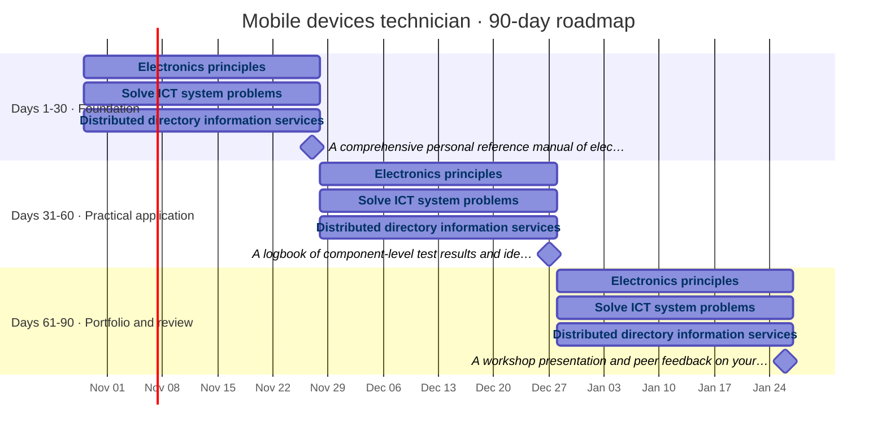
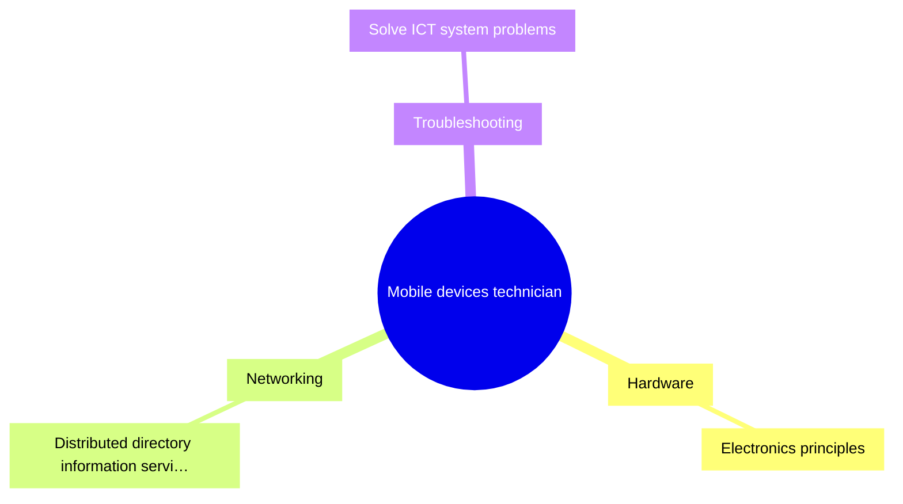

# Reskilling plan: Mobile devices technician

3 skills in the plan · 6 hours a week · 90 days

> 52 more skill gaps are deferred until after these 90 days: Ensure proper document management, Implement ICT recovery system, Mobile operating systems, Use precision tools, Disassemble mobile devices …

## Roadmap timeline

## Skill dependencies

## Skill gaps

| | Current level | Target level |
|---|---|---|
| Electronics principles | 0 | 3 |
| Distributed directory information servic | 0 | 2 |
| Solve ICT system problems | 0 | 2 |

## Skill map

## Weekly effort

> Every phase fits your weekly learning time.

| | Planned hours per week | Your capacity (6 h/week) |
|---|---|---|
| Days 1-30 · Foundation | 6 | 6 |
| Days 31-60 · Practical application | 6 | 6 |
| Days 61-90 · Portfolio and review | 6 | 6 |

## Skills and resources

- **Electronics principles** (Hardware, high priority): level 0 → 3
  - project: Build a foundational knowledge base of electronic components and circuit theory using ESCO: Electronics principles. · 15 h
  - guide: [ESCO v1.2: Mobile devices technician — Electronics principles](https://esco.ec.europa.eu/en/classification/occupation?uri=http%3A%2F%2Fdata.europa.eu%2Fesco%2Foccupation%2Fb37d15b3-402e-4792-8292-f18c0de7aca6)
  - guide: [ESCO: Electronics principles (definition, related skills and occupations)](https://esco.ec.europa.eu/en/classification/skill?uri=http://data.europa.eu/esco/skill/557d1221-0235-4a48-ada5-8fca73443627)
  - project: Apply electronics principles to perform component-level testing on decommissioned mobile devices. · 15 h
  - project: Lead a technical workshop demonstrating advanced electronics troubleshooting for your team. · 15 h
- **Solve ICT system problems** (Troubleshooting, medium priority): level 0 → 2
  - project: Develop a systematic diagnostic framework for mobile hardware failures based on ESCO: Solve ICT system problems. · 10 h
  - guide: [ESCO v1.2: Mobile devices technician — Solve ICT system problems](https://esco.ec.europa.eu/en/classification/occupation?uri=http%3A%2F%2Fdata.europa.eu%2Fesco%2Foccupation%2Fb37d15b3-402e-4792-8292-f18c0de7aca6)
  - guide: [ESCO: Solve ICT system problems (definition, related skills and occupations)](https://esco.ec.europa.eu/en/classification/skill?uri=http://data.europa.eu/esco/skill/9e06bac6-6b91-48ca-8b7d-c1f48cdecd7c)
  - project: Execute a structured diagnostic process on live repair tickets using ESCO: Solve ICT system problems. · 10 h
  - project: Conduct a root-cause analysis project on recurring ICT system problems in your department. · 10 h
- **Distributed directory information services** (Networking, medium priority): level 0 → 2
  - project: Research the architecture of distributed directory services using ESCO: Distributed directory information services. · 0.7 h
  - guide: [ESCO v1.2: Mobile devices technician — Distributed directory information services](https://esco.ec.europa.eu/en/classification/occupation?uri=http%3A%2F%2Fdata.europa.eu%2Fesco%2Foccupation%2Fb37d15b3-402e-4792-8292-f18c0de7aca6)
  - guide: [ESCO: Distributed directory information services (definition, related skills and occupations)](https://esco.ec.europa.eu/en/classification/skill?uri=http://data.europa.eu/esco/skill/d1e954cd-d290-4d80-97c0-7969960d2928)
  - project: Configure a local directory service client to test connectivity and authentication protocols. · 0.7 h
  - project: Audit and optimize the directory service settings for a fleet of mobile devices. · 0.7 h
