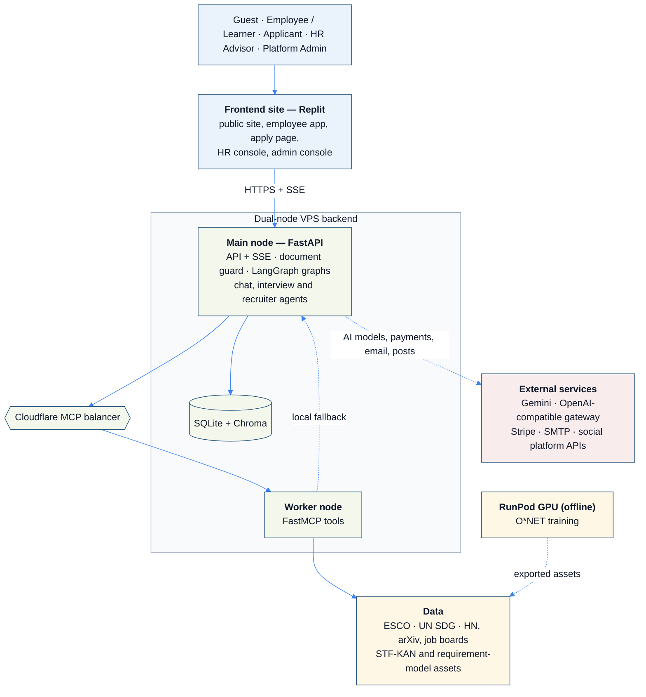

# SDC Hackathon 2026: Phase 1 Preliminary Project Proposal

Answers for `Submission Template SDC Hackathon.pdf`, written from what the repository and the deployed
application actually do. Copy them into the PDF form and save it as `SDC2026_NoBugPls_Preliminary.pdf`.
Word counts are given per answer.

## 1. Team & Project Overview

| Field | Answer |
|---|---|
| Team Name | NoBugPls |
| Selected Domain | Domain 1 |
| Selected SDG Track (1–17) | SDG 8: Decent Work and Economic Growth (secondary: SDG 4, Quality Education) |
| Project / Solution Name | AiversePulse Enterprise |
| Name (Leader) | Tang Yu Shan |
| Email & Phone (Leader) | Entered on the submitted form (not published in the repository) |
| University Affiliation(s) | Universiti Teknologi Malaysia (UTM); Universiti Tunku Abdul Rahman (UTAR) |
| Number of Team Members | 5 |

## 2. Executive Summary & Problem Statement

### 2.1 The Problem Context (≈ 185 words, limit 250)

Artificial intelligence is changing what jobs require faster than workers and employers can adapt. The World
Economic Forum's *Future of Jobs Report 2025* finds that employers expect 39% of the key skills required in the
job market to change by 2030. If the world's workforce were 100 people, 59 would need training by 2030, and 11
of them are unlikely to receive it. The same report projects 170 million jobs created and 92 million displaced
this decade.

The people most affected are mid-career and lower-skilled workers in routine roles, and the HR teams
responsible for them. Workers cannot see which of their skills are rising or fading, or which nearby roles they
could move into. HR teams plan training and screen candidates using job descriptions that lag behind the
technology. AI résumé screeners add a new risk: hidden text can manipulate them unseen ("prompt injection").

The economic cost is skills mismatch and avoidable displacement. The social cost falls hardest on workers
without access to career guidance. That widens inequality and works against decent work for all (SDG 8.5)
and relevant skills for employment (SDG 4.4).

*Source: World Economic Forum (2025), Future of Jobs Report 2025, https://www.weforum.org/publications/the-future-of-jobs-report-2025/*

### 2.2 The Proposed AI Solution (≈ 295 words, limit 300)

AiversePulse is a deployed web application for workers, HR teams and job applicants. AI agents,
orchestrated with LangGraph and connected through a Model Context Protocol (MCP) tool server, do the work:

1. **Skills intake.** A 13-scenario quick-match game, or a résumé upload. Each skill found is mapped to ESCO,
   the European Commission's taxonomy of 2,938 occupations, and keeps the line that proves it.
2. **Daily AI-trend board.** Hacker News, arXiv and job postings are scored into "emerging" and
   "automation pressure" per occupation, with dated sources.
3. **Prediction.** Models trained offline on O*NET predict how important each skill is, and a STF-KAN
   forecaster ranks skills likely to rise.
4. **Matching, gaps and a cited plan.** Agents rank future roles, compute skill gaps under *assistive* and
   *agentic* AI scenarios, and write a 30/60/90-day plan for the learner's weekly hours. Plans stay drafts until a
   named person approves them; roles link to UN SDG targets.
5. **Practice and help.** A 3D mock interviewer asks ESCO-grounded questions by voice or text and scores
   answers; a chat assistant answers from the person's own plans.
6. **Responsible hiring.** HR writes requirements in plain English and shares a public apply link. A document
   guard strips hidden text and injected instructions; screening agents rank applicants blind; a human decides.
   A posting agent shares openings to LinkedIn, Facebook, X, Telegram, Discord and Slack.

Workshop skills used:
- **GenAI APIs:** Gemini and an OpenAI-compatible gateway for coaching, chat, interviews, speech-to-text and job
  posts; HR picks the model per task from an admin allow-list.
- **Database architecture:** SQLite for accounts, versioned plans, approvals, audit log and trend history, plus a
  Chroma vector store of 18,444 passages for retrieval.
- **Cloud hosting:** the frontend on Replit, a dual-node VPS backend behind a Cloudflare MCP balancer, and RunPod
  GPUs for model training.

## 3. Technical Architecture & Implementation Plan

### 3.1 Conceptual Tech Stack

- **Frontend:** static HTML/CSS/JavaScript ES modules (no build step) on Replit; Three.js for the 3D interviewer,
  GSAP for motion, a rigged SVG owl companion. Any number of frontend sites can use the same backend.
- **Backend:** a dual-node VPS. The main node (FastAPI, Server-Sent Events) runs the API, the document guard, two
  LangGraph graphs (reskilling; résumé screening) and the chat, mock-interview and recruiter agents. A worker node
  runs the FastMCP tools behind a Cloudflare MCP balancer, with an in-process fallback on the main node.
- **Data and AI:** SQLite and Chroma; sentence-transformers MiniLM; PyTorch (STF-KAN forecaster, requirement
  model); Gemini 3.1 Flash-Lite and an OpenAI-compatible gateway (optional, chosen per task).
- **Public data:** ESCO v1.2, the UN SDG API, Hacker News, arXiv, Arbeitnow and Remotive. O*NET 31.0 is used for
  training only.
- **Services:** Stripe (plans and payment), SMTP (verification, password reset and invites), social platform
  APIs (job posts), RunPod Serverless GPU (`runpod/handler.py`) for training.

Block diagram (the README has the full set of diagrams):

**Sponsor-provided GenAI API or cloud platform** (proof of use in `submission/`):
- **Replit:** frontend hosting and development (`.replit`); see `REPLIT PROOF OF USE.pdf`.
- **RunPod:** GPU training and batch-embedding jobs through a serverless endpoint; see `RUNPOD PROOF OF USE.pdf`.
- **Gemini:** GenAI API for routing and narration, alongside an OpenAI-compatible gateway.

### 3.2 Design-Thinking & Deployment Strategy (≈ 175 words, limit 200)

- **Empathise:** we started from an anxious worker asking "what next?", an HR advisor under hiring and training
  pressure, and an applicant who deserves a fair read. All need answers they can trust, so every claim cites a
  dated public source and nothing is final until a person approves it.
- **Define:** we mapped the brief to must-haves and traced each one to code and tests (`docs/requirements_trace.md`).
- **Ideate:** a quiz for speed and a résumé for depth, two AI scenarios instead of one prediction, and agents
  that recommend while humans decide.
- **Prototype:** a working, deployed product, not mock-ups: streaming agent progress, a 3D interviewer, voice
  input, and accessible layouts for desktop and mobile.
- **Test:** 180 automated Python tests and 8 UI tests run on every push, including red-team PDFs with hidden
  injections and honest model evaluation against baselines.

Deployment: the frontend deploys on its own and calls one backend; the backend runs on two VPS nodes behind
Cloudflare, needs no GPU at runtime, refreshes trend data daily, and deploys automatically from the main branch.

## 4. Preliminary Environmental & SDG Impact Framework

| Metric Category | Response |
|---|---|
| **Target SDG Sub-Target(s)** | **Target 4.4:** "By 2030, substantially increase the number of youth and adults who have relevant skills, including technical and vocational skills, for employment, decent jobs and entrepreneurship." **Target 8.5:** "full and productive employment and decent work for all." |
| **Current Problem Baseline** | 59 of every 100 workers will need training by 2030, and 11 of them are unlikely to receive it (WEF Future of Jobs Report 2025). 39% of key skills are expected to change by 2030 (same source). Without a tool, a person must manually compare their skills against occupation requirements. In Phase 2 we will measure the team's own baseline: the minutes a volunteer needs to produce a skills-gap list and plan with online search alone. |
| **Core Measurable KPI** | (1) Time from first visit to an approved, cited 90-day plan (minutes). (2) Share of plan recommendations backed by a verifiable source (%). (3) Share of hidden prompt-injection attacks removed before AI screening (%). (4) Error of predicted skill importance against held-out expert ratings (MAE). |
| **Phase 2 Impact Target** | (1) **≥ 80% less time** to a personalised plan than the manual baseline in a user test (target under 5 minutes). (2) **100%** of plan activities cite a source; the Reviewer agent blocks unsupported claims, already enforced in tests. (3) **100%** of the attacks in our red-team suite removed: currently 9 tests covering white text, micro fonts, off-page text, PDF metadata, DOCX hidden/white runs, zero-width characters and visible injection lines, all passing; the suite grows for Phase 2. (4) Importance error **≥ 25% below** a simple baseline on held-out occupations; currently 0.373 vs 0.504 MAE (26% lower; `src/data/snapshots/esco_requirements_card.json`). |

## 5. Eligibility & Readiness Checklist

- [ ] All team members completed the GenAI, Database and Cloud Deployment workshops (confirmed by the team leader on the form)
- [x] The concept addresses a verified real-world problem mapped to UN SDGs (4.4, 8.5)
- [x] The solution is a functional, deployed application (frontend on Replit, backend at sdc.olgtx.com; see README "How to Run")
- [x] All fields completed within word limits

## 6. IP & Originality Declaration

### 6.1 Pre-Existing / Prior-Owned Work
No pre-existing team code is included. The repository's history begins with the initial commit on
19 October 2026, and all application code, models and generated assets were created during the hackathon.
Third-party code, data and models are listed in 6.2.

### 6.2 Third-Party Code, Datasets, or Models: Yes

| Name | Type | License |
|---|---|---|
| ESCO v1.2 (European Commission) | dataset | Free reuse with attribution (Commission Decision 2011/833/EU) |
| O*NET 31.0 Database and release history (USDOL/ETA) | dataset (training only) | CC BY 4.0 |
| data_jobs (Luke Barousse, HF `Ashy24/data_jobs`) | dataset (training only) | Apache-2.0 |
| UN SDG goals and targets (UN Statistics Division API) | dataset | UN public information |
| Hacker News (Algolia API), arXiv API, Arbeitnow, Remotive | data (counts and short excerpts) | public API terms |
| sentence-transformers/all-MiniLM-L6-v2 | pre-trained model | Apache-2.0 |
| Gemini API; OpenAI-compatible gateway models (incl. mimo-v2.6-flash, gpt-image-2) | hosted AI services; generated images in `src/web/img/` | provider terms of service |
| FastAPI, LangGraph, FastMCP, Chroma, PyTorch, pandas, NumPy, scikit-learn, httpx, Pillow, cryptography | code | MIT / Apache-2.0 / BSD / HPND |
| pypdf, pdfplumber, pikepdf, PyMuPDF, python-docx | code | BSD / MIT / MPL-2.0 / AGPL-3.0 (PyMuPDF, used only in tests) |
| Three.js | code (3D interviewer) | MIT |
| GSAP and ScrollTrigger | code (animation) | GreenSock Standard "no charge" license |
| Lucide icons; Simple Icons (platform logos) | icons | ISC; CC0 (logos are trademarks of their owners) |
| Stripe.js | code (payments, loaded from Stripe) | Stripe terms of service |
| pdf-prompt-injection-toolkit (zhihuiyuze) | detection techniques referenced, no code copied | MIT |

### 6.3 Employment-Related IP Conflicts
Declared by the team leader on the submitted form (Yes / No).

## 7. Declaration
Signed and dated by the team leader, Tang Yu Shan, on the submitted form.
